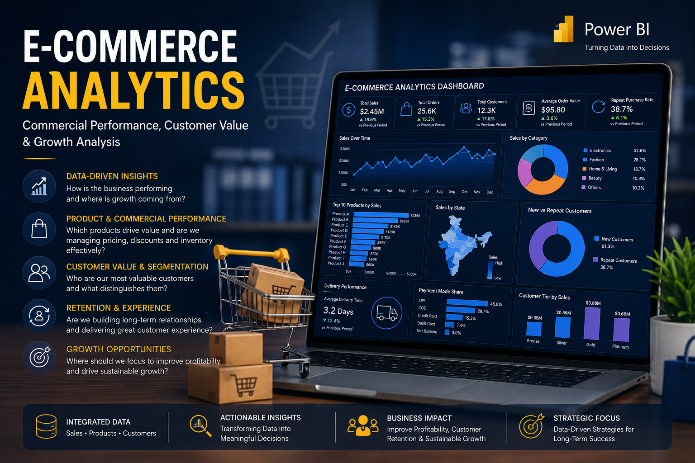
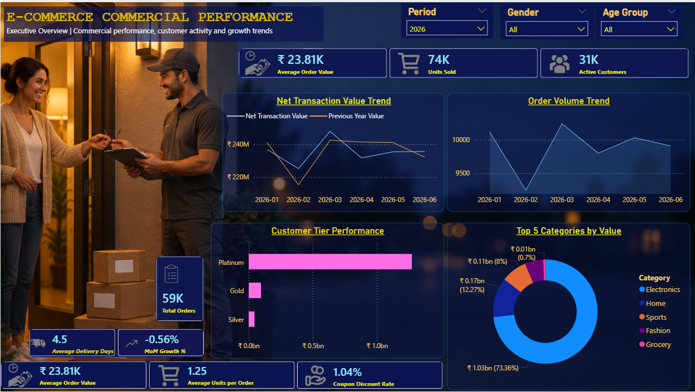
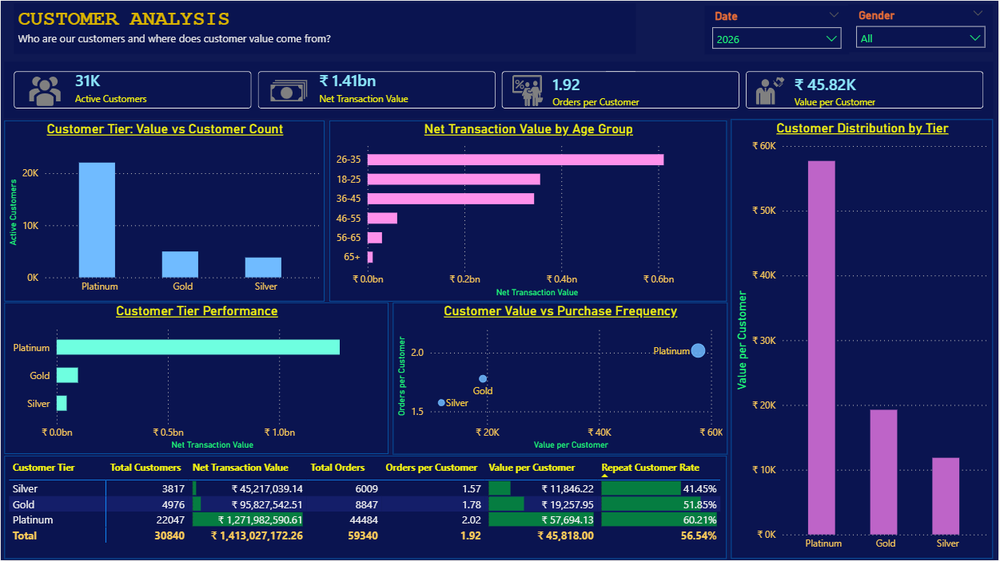
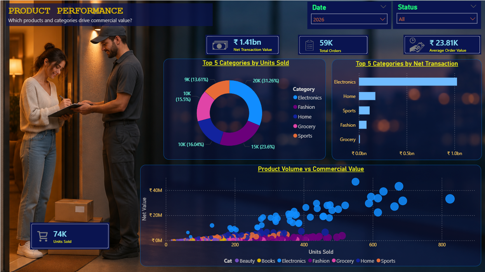
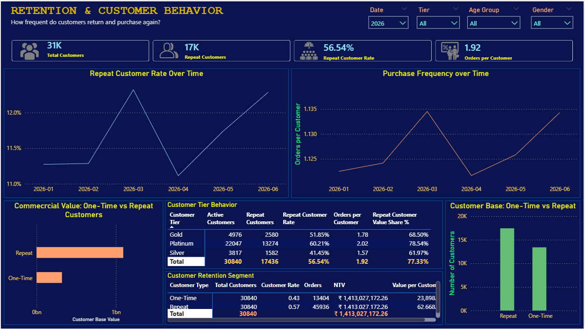
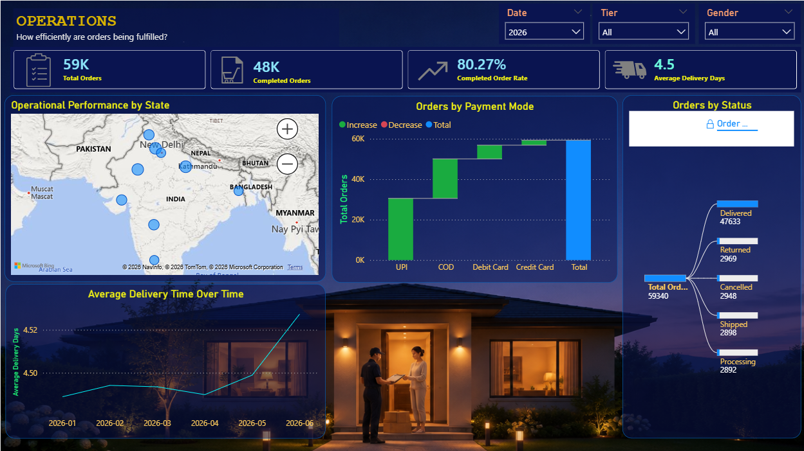
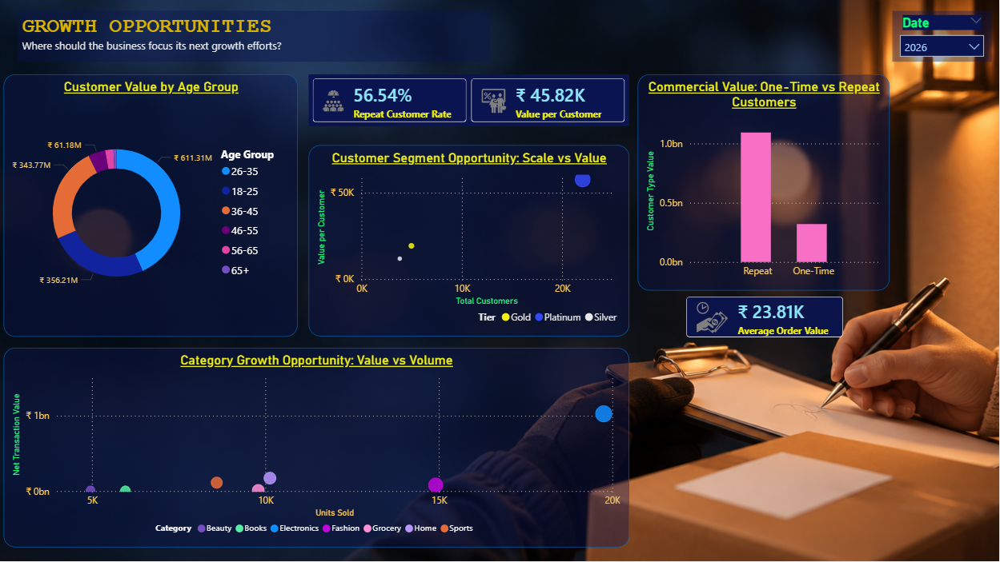

<h1 align="center">E-Commerce Sales Analytics Case Study</h1>

<p align="center">

</p>

<p align="center">
<b>A six-page Power BI dashboard built on 250,000 orders. It shows that Platinum-tier customers (71% of buyers) generate 90% of revenue, and that repeat buyers account for 77% of it.</b>
</p>

<p align="center">


</p>

---

## At a glance (Jan–Jun 2026)

| Metric | Value | What it tells management |
|---|---|---|
| Net transaction value | **₹1.41 bn** | Flat compared with Jan–Jun 2025 (−0.1%), so new growth has to come from somewhere |
| Revenue from Electronics | **73%** | The business depends heavily on one category |
| Revenue from Platinum tier | **90%** (from 71% of customers) | Platinum customers spend **4.9×** as much as Silver customers |
| Revenue from repeat customers | **77%** (from 57% of customers) | Retention is the main lever for growth |
| Order fulfilment rate | **80.3%** | About 10% of orders end in a cancellation or return |
| Average delivery time | **4.5 days** | Delivery is steady and is not hurting performance |

---

## 1. The problem

> *"Client's sales have stopped growing and they don't know where to focus. They are uncertain about Which products and customers actually bring in the money, whether those customers are coming back, and where is the business losing orders? Client needs a dashboard that leadership can use to decide where to put the next rupee."*

The project answers 12 business questions grouped into six areas: overall performance, products, customer value, retention, operations and growth opportunities. The full question list, KPI definitions and the decision each question supports are in the [analysis charter](documentation/analysis_charter.md).

## 2. The data

| Table | Rows | Grain | Key fields |
|---|---|---|---|
| `sales.csv` | 250,000 | One order (one product per order) | dates, quantity, price, coupon, payment mode, status, rating, state |
| `customers.csv` | 40,000 | One customer | age group, state, registration date, customer tier |
| `products.csv` | 2,000 | One product | category, brand, price, discount, stock, rating |

- **Time range:** June 2024 to June 2026 (25 months). The dashboard focuses on Jan–Jun 2026 and compares it with the same period a year earlier.
- **Market:** India. All values are in Indian rupees (₹), across 7 product categories.
- **Data quality:** The data had no duplicate keys and no duplicate rows. The only large gaps were coupon codes (80% blank, meaning no coupon was used) and ratings or reviews (52% blank, meaning the order was not rated). These blanks were kept as meaningful values rather than filled in. The reasoning is in [data preparation decisions](Analysis/data_preparation_decisions.md).

## 3. Approach

```
Raw CSVs ──► Python profiling ──► Python cleaning & feature engineering ──► Star schema ──► DAX measures ──► 6-page Power BI report
```

1. **Profiling** ([`01_data_profiling.ipynb`](Analysis/01_data_profiling.ipynb)): checked row counts, key uniqueness, missing values and value ranges, and recorded the results in [data quality checks](Analysis/data_quality_checks.md).
2. **Preparation** ([`02_data_preparation.ipynb`](Analysis/02_data_preparation.ipynb)): standardised column names and types, dropped personal data (names, emails, phone numbers), and derived new fields: delivery days, order hour, day of week, quarter, coupon flag and customer tenure.
3. **Data modelling** ([`data_modeling.md`](Analysis/data_modeling.md)): built a star schema with `Fact_Sales` linked to `Dim_Customers`, `Dim_Products` and a `Dim_Date` table for time intelligence.
4. **DAX measure layer** ([`DAX_measure_layer.md`](powerbi/DAX_measure_layer.md)): created measures for revenue, AOV, year-over-year and month-over-month growth, repeat-customer rate, fulfilment and cancellation rates, and value per customer.
5. **Dashboard** ([`.pbix`](powerbi/e-commerce-sales-analytics.pbix)): built six pages, each answering a single business question, with slicers for period, gender and age group.

## 4. Results

### Executive Overview: how is the business performing?

<p align="center">

</p>

- Revenue for Jan–Jun 2026 was **₹1.41 bn** from **59,340 orders**, with an average order value of **₹23.8K**. That is level with the same period in 2025, so the business is holding steady rather than growing.
- **Electronics brought in ₹1.03 bn (73%)**, which is more than every other category combined and about six times the next category, Home (12%).
- **All of the top 10 products are electronics.** The Noise Watch V1 (₹46.9M) and Samsung Mobile V4 (₹43.2M) lead the list.

### Customer Analysis: where does customer value come from?

<p align="center">

</p>

- **Platinum customers make up 71% of active customers and bring in 90% of revenue.** Each one is worth **₹57.7K** on average, compared with ₹19.3K for Gold and ₹11.8K for Silver.
- Platinum customers also come back most often: **60% of them are repeat buyers**, against 52% for Gold and 41% for Silver.
- **Customers aged 26–35 account for 43% of revenue**, the largest share of any age group.
- **57% of customers bought more than once, and those repeat customers produced 77% of revenue.**

### Operations

- **80.3% of orders were delivered.** Cancellations (5.0%) and returns (5.0%) together cover about **10% of orders and ₹139M in order value**.
- **UPI is used for 51% of orders** and cash on delivery for 33%.
- Uttar Pradesh, Haryana and Rajasthan place the most orders, with about 7,500–7,800 each.

<details>
<summary><b>View the other dashboard pages</b> (Product Performance, Retention, Operations, Growth Opportunities)</summary>
<br>

**Product Performance**


**Retention & Customer Behavior**


**Operations**


**Growth Opportunities**


</details>

## 5. Recommendations

| # | Finding | Recommended action |
|---|---|---|
| 1 | Revenue is flat and 77% of it comes from repeat customers | **Make retention the main growth lever.** Target first-time buyers with a second-purchase offer, since converting them is cheaper than finding new customers. |
| 2 | Platinum customers bring in 90% of revenue, and only 41% of Silver customers buy again | **Protect Platinum and move Silver and Gold up.** Give Platinum customers priority service, and give lower tiers clear rewards for reaching the next tier. |
| 3 | 73% of revenue depends on Electronics | **Lower the concentration risk.** Cross-sell Home and Sports products to Electronics buyers, which works as both a growth play and a hedge. |
| 4 | About 10% of orders are cancelled or returned | **Find out why.** Break cancellations and returns down by product, state and payment mode to find avoidable losses. |
| 5 | Customers aged 26–35 bring in 43% of revenue | **Aim marketing and the product range at this age group** and their channels, especially UPI-first mobile shoppers. |

> **Note on scope:** The dataset has no cost-of-goods data, so this analysis measures **revenue and commercial value, not profit**. Adding product costs would be the next step to turn these findings into margin decisions.

---

## How to run

**View the dashboard**
1. Install [Power BI Desktop](https://www.microsoft.com/power-bi/desktop) (Windows).
2. Open `powerbi/e-commerce-sales-analytics.pbix`. 
    * It reads the cleaned CSVs in `data/processed/`, so you don't need to run the notebooks first.

**Reproduce the data preparation**
```bash
git clone https://github.com/Vin-Okumu/e-commerce-sales-analytics.git
cd e-commerce-sales-analytics
pip install pandas numpy jupyter
cd Analysis
jupyter notebook   # run 01_data_profiling, then 02_data_preparation
```
The notebooks read from `data/raw/` and write to `data/processed/`.

<details>
<summary><b>Repository structure</b></summary>

```
e-commerce-sales-analytics/
├── Analysis/
│   ├── 01_data_profiling.ipynb        # Data profiling
│   ├── 02_data_preparation.ipynb      # Cleaning & feature engineering
│   ├── data_quality_checks.md
│   ├── data_preparation_decisions.md
│   └── data_modeling.md               # Star schema design
├── data/
│   ├── raw/                           # sales, customers, products
│   └── processed/                     # Fact_Sales, Dim_Customers, Dim_Products
├── documentation/
│   ├── analysis_charter.md            # Business questions & KPI definitions
│   ├── analysis_report.md
│   └── data_dictionary.md
├── powerbi/
│   ├── e-commerce-sales-analytics.pbix
│   ├── DAX_measure_layer.md
│   └── proposed_structure.md
├── screenshots/                       # Dashboard pages
└── images/Cover.png
```
</details>
